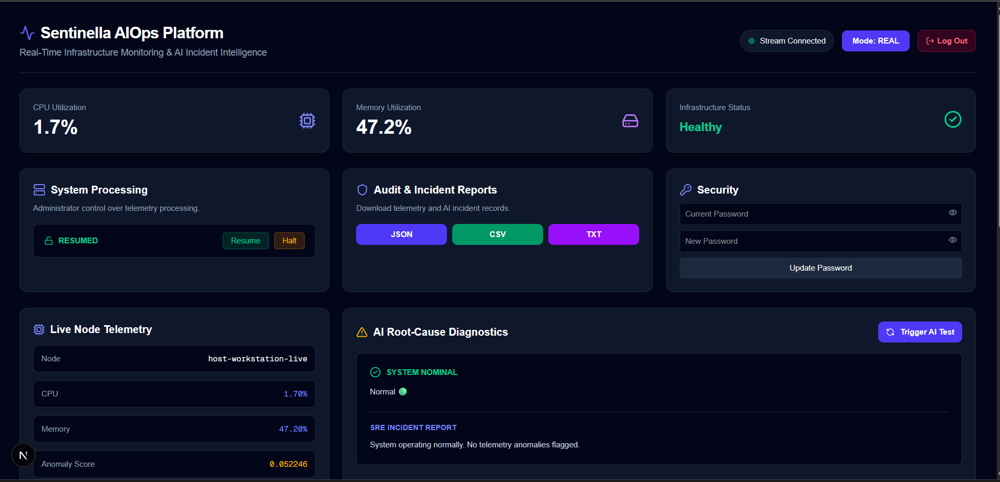

# Sentinella Enterprise AIOps


A real-time infrastructure monitoring platform that combines
machine learning anomaly detection with LLM-powered SRE diagnostics.



## What It Does

Sentinella continuously collects system telemetry (CPU, memory, top
processes) from monitored nodes, streams it to a Next.js dashboard
over WebSockets, and runs it through a dual-stage AI pipeline:

1. **Isolation Forest** — unsupervised anomaly detection on CPU/memory.
2. **Gemini SRE Diagnosis** — when an anomaly is detected, Google's
   Gemini API generates a root-cause analysis and remediation steps.

Admins can halt or resume telemetry processing, export audit reports
(JSON/CSV/TXT), and manage user roles.

## Architecture

```
  ┌──────────────┐          ┌──────────────────┐
  │ System Agent │──POST──▶│  FastAPI Backend  │
  │  (agent.py)  │          │  (async, JWT)    │
  └──────────────┘          └─────────┬────────┘
                                      │
                          ┌───────────┴───────────┐
                          ▼                       ▼
                   ┌────────────┐          ┌──────────────┐
                   │   Celery   │          │  WebSocket   │
                   │   Worker   │          │ /ws/telemetry│
                   └─────┬──────┘          └──────┬───────┘
                         │                        │
                         ▼                        ▼
                  ┌──────────────┐         ┌──────────────┐
                  │ Isolation    │         │   Next.js    │
                  │ Forest       │         │   Dashboard  │
                  └──────┬───────┘         └──────────────┘
                         │
                  ┌──────▼───────┐
                  │  Gemini API  │
                  │ (SRE report) │
                  └──────────────┘
```

## Tech Stack

**Backend:**

- FastAPI (async), SQLAlchemy 2.0 (async), Alembic
- PostgreSQL (asyncpg for API, psycopg2 for worker)
- Celery + Redis
- Isolation Forest (scikit-learn)
- Google Gemini API
- Argon2 password hashing, JWT auth

**Frontend:**

- Next.js 16, React 19, TypeScript
- Tailwind CSS 4
- WebSockets

**Infrastructure:**

- Docker + docker-compose (4 services)
- PostgreSQL 15, Redis 7

## Features

- Real-time telemetry streaming via WebSockets
- Isolation Forest anomaly detection
- Gemini-powered SRE root-cause analysis
- JWT auth with admin/operator roles
- Admin system control (halt/resume processing)
- Audit report export (JSON/CSV/TXT)
- Simulated + real telemetry modes
- Docker Compose deployment

## Running With Docker

```bash
cp .env.example .env
# Edit .env with your values
docker-compose up --build
```

- Backend: http://localhost:8000
- Frontend: http://localhost:3000

## Environment Variables

```
POSTGRES_USER=sentinella
POSTGRES_PASSWORD=change-me
POSTGRES_DB=sentinelladb
SECRET_KEY=change-me-to-a-43-char-random-string
DEFAULT_ADMIN_USERNAME=admin
DEFAULT_ADMIN_PASSWORD=change-me
GEMINI_API_KEY=your-gemini-api-key
DATABASE_URL=postgresql://sentinella:change-me@db:5432/sentinelladb
CELERY_BROKER_URL=redis://redis:6379/0
CELERY_RESULT_BACKEND=redis://redis:6379/0
MODEL_PATH=/app/models/anomaly_model.joblib
```

## Running Without Docker

### Backend

```bash
cd backend
python -m venv venv
venv\Scripts\activate
pip install -r requirements.txt
alembic upgrade head
uvicorn app.main:app --reload
```

### Celery Worker

```bash
cd backend
celery -A app.worker.celery_app worker --loglevel=info
```

### System Agent (telemetry producer)

```bash
python agent.py
```

### Frontend

```bash
cd frontend
npm install
npm run dev
```

## API Endpoints

| Method | Endpoint | Purpose |
|---|---|---|
| POST | `/token` | Login (JWT) |
| POST | `/auth/register` | Public registration (operator) |
| POST | `/admin/users` | Create user (admin only) |
| POST | `/telemetry/` | Ingest telemetry |
| GET | `/telemetry/` | List telemetry history |
| POST | `/ai/diagnose` | Trigger AI diagnosis |
| POST | `/system/control` | Halt/resume processing (admin only) |
| GET | `/admin/export-reports` | Export reports (JSON/CSV/TXT) |
| WS | `/ws/telemetry` | Real-time telemetry stream |
| GET | `/health` | Health check |

## License

MIT